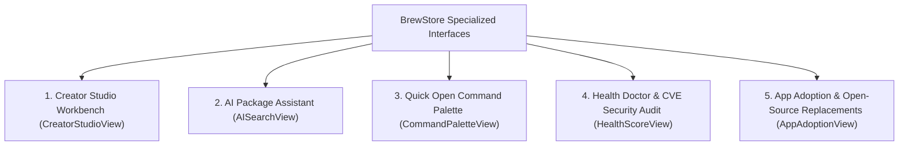

# 🤖 BrewStore Creator Studio, AI Assistant & Security Diagnostics: Feature Test Guide

This document details **EVERY SINGLE feature, maintainer tool, AI recommendation workflow, and security diagnostic interface** in BrewStore: **Creator Studio Workbench**, **AI Package Assistant**, **Command Palette**, **Security & CVE Auditor**, and **App Adoption & Migration Engine**.

---

## 🧭 Overview of Advanced Auxiliary Interfaces

---

## 🔨 1. Creator Studio Maintainer Workbench (`CreatorStudioView.swift`)

The specialized workbench for tap maintainers and formula authors:

### 1.1 Maintainer Telemetry & Repository Dashboard
- **GitHub Star & Analytics Overview**:
  - Live star counts, fork metrics, and open issue counters for tapped repositories.
  - Local installation telemetry (e.g. `321 active installations`).
  - Active maintainer tap badges.
- **Repository List**:
  - Displays local git repositories under Homebrew taps.
  - 1-Click "Reveal in Finder" and "Open in Terminal".

### 1.2 Formula Generator Wizard (`NewFormulaWizardSheet.swift`)
- **Step-by-Step Formula Scaffolding**:
  - Input project name, upstream release tarball URL, and homepage.
  - 1-Click "Fetch SHA-256 Checksum" from remote release URL.
  - Dependency configuration builder (`depends_on "cmake" => :build`, `depends_on "rust"`).
  - Test block generator (`test do ... end`).
- **Live Ruby Code Generator**:
  - Generates standard syntax-highlighted Homebrew ruby formula code (`class MyTool < Formula ... end`).
  - 1-Click "Save to Local Tap" or "Copy Formula Code".

### 1.3 Formula Linter & Auditor (`brew audit`)
- **Automated Quality Checks**:
  - Runs `brew audit --strict --online <formula>` directly from the UI.
  - Categorizes findings into *Errors*, *Warnings*, and *Style Suggestions*.
  - 1-Click "Fix Formatting" suggestions.

### 1.4 Custom Tap Repository Scaffolder
- **1-Click Tap Creation**:
  - Generates the standard Homebrew tap directory structure (`Formula/`, `Casks/`, `README.md`, `.github/workflows/tests.yml`).

---

## 🤖 2. AI Package Assistant (`AISearchView.swift`)

The offline-capable, intent-based natural language recommendation engine:

### 2.1 Natural Language Query Input
- **Search Prompt Bar**:
  - Free-form text input accepting tasks and descriptions (e.g. *"Batch convert HEIC photos to PNG"*, *"GPU accelerated terminal emulator"*, *"Run local AI and LLMs on Mac"*).
  - `Ask Assistant` button and input clear button.

### 2.2 8 Quick Prompt Workflow Pills
- Horizontal pill strip featuring pre-indexed workflows:
  1. *"Batch convert HEIC photos to PNG"*
  2. *"Convert MKV video to MP4 with subtitles"*
  3. *"GPU accelerated terminal emulator"*
  4. *"Run local AI and LLMs on Mac"*
  5. *"Fastest Docker container engine"*
  6. *"Database GUI for PostgreSQL & Redis"*
  7. *"Search code recursively like lightning"*
  8. *"Encrypt files simply with SSH keys"*

### 2.3 Scored Recommendation Cards
- **Match Confidence Percentage**: Displays percentage match badge (e.g. `95% match`).
- **Classification Pill**: Identifies whether the solution is a `CLI Tool` or `macOS App`.
- **Headline & Rationale**: Explains *why* the tool is recommended.
- **Specific Use Cases & Feature Tags**: `Rust`, `GPU`, `Apple Silicon`, `Metal`, `Encryption`, `Batch`.
- **Integrated Action Button**: Direct `GET` / `UPDATE` / `OPEN` / `INSTALLED` pill with live installation feedback.

---

## ⚡ 3. Quick Open Command Palette (`CommandPaletteView.swift`)

The keyboard-first, spotlight-style command and navigation hub (triggered via **⌘K** or toolbar):

### 3.1 Global Search & Fuzzy Matching
- **Package Results Section**:
  - Searches across all installed and catalog packages.
  - Displays icon, name, ID, and installed badge.
  - Displays yellow `star.fill` (if wishlisted) and orange `pin.fill` (if pinned).
  - Pressing Return opens `PackageDetailView` directly.
- **Navigation & Actions Section**:
  - Jump to any section (`Discover`, `Installed`, `Services`, `Taps`, `Settings`).
  - Trigger maintenance actions (`Upgrade All Packages`, `Run Doctor Diagnostics`, `Clean Cache`, `Benchmark CDN Mirrors`).

### 3.2 Keyboard Navigation
- Arrow Up/Down navigation across results.
- `Escape` key dismisses palette instantly.
- `Return` activates the selected action or package.

---

## 🩺 4. Health Doctor & CVE Security Audit (`HealthScoreView.swift` & `CVESecurityView.swift`)

The comprehensive diagnostic and security hardening suite:

### 4.1 System Health Score (0–100) & Grade
- Dynamic score computation factoring in pending updates, cache size, broken symlinks, and doctor warnings.
- Grade display (A / B / C / D) with color-coded status rings.

### 4.2 Toolchain Dependency Doctor (`BrewStoreDependencyDoctorManager`)
- **Automated Issue Detection**:
  - Orphaned packages (`brew autoremove`).
  - Unlinked Cellar binaries.
  - Missing dependent libraries (`brew missing`).
- **1-Click "Auto-Heal Toolchain"**:
  - Sequentially executes link repair, unneeded dependency removal, and cleanup.

### 4.3 CVE Security Vulnerability Scanner (`CVESecurityView`)
- Scans installed packages against known CVE vulnerability advisories.
- Displays severity level (*Critical*, *High*, *Medium*, *Low*), affected versions, and 1-click update triggers.

---

## 🔄 5. App Adoption & Open-Source Replacements (`AppAdoptionView.swift`)

The migration engine for bringing external apps under Homebrew management and replacing paid software:

### 5.1 Adopt Unmanaged Apps Tab
- **Local Application Scanner (`BrewStoreAppAdoptionManager`)**:
  - Scans `/Applications` for GUI apps installed outside Homebrew (e.g. from web DMGs).
  - Matches bundle identifiers against Homebrew Cask database.
  - 1-Click "Adopt All" or individual "Adopt to Homebrew Cask".

### 5.2 Open-Source Replacements Tab (`AppReplacementView.swift`)
- **Curated FOSS Alternatives Directory**:
  - Suggests 100% Free & Open-Source Homebrew replacements for proprietary/paid apps (e.g. `mole` for CleanMyMac, `bitwarden` for 1Password, `iina` for QuickTime/VLC, `blender` for Maya, `inkscape` for Illustrator).
- **Replacement Cards**:
  - Proprietary app comparison, key advantages bullet points, Star toggle, Pin badge, and 1-click install.

---

## 📋 Computer Use Verification Checklist

1. [ ] **Creator Studio**:
   - Open Creator Studio ➔ Check maintainer telemetry and tap list.
   - Click Formula Generator ➔ Input sample URL and verify SHA-256 calculation.
2. [ ] **AI Assistant**:
   - Click quick prompt *"Batch convert HEIC photos to PNG"* ➔ Observe `ImageMagick` recommendation with `95% match`.
   - Click quick prompt *"Run local AI and LLMs on Mac"* ➔ Observe `Ollama` and `LM Studio` recommendations.
3. [ ] **Command Palette (⌘K)**:
   - Press ⌘K ➔ Search `"ffmpeg"` ➔ Observe package result with badges.
   - Select a command ➔ Verify navigation.
4. [ ] **Health Score & Security Doctor**:
   - Open Health Score sheet ➔ Verify score calculation and Auto-Heal button.
   - Click CVE Audit link ➔ Verify security vulnerability scan list.
5. [ ] **App Adoption & Replacements**:
   - Open Adoption ➔ Switch to Open-Source Replacements tab ➔ Verify replacement cards (`mole`, `bitwarden`, etc.).
