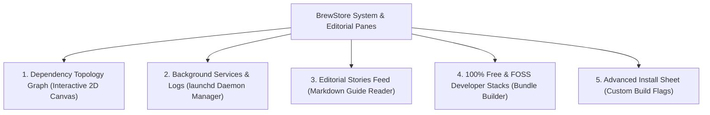

# 🤖 BrewStore Dependency Topology, Background Services, Stories & Stacks: Feature Test Guide

This document details **EVERY SINGLE feature, interactive gesture, service telemetry metric, and curated bundle workflow** across BrewStore's:

1. **Interactive Dependency Topology Graph** (`DependencyTopologyView.swift` & `DependencyGraphView.swift`)
2. **Background Services & Live Log Inspector** (`ServicesView.swift` & `ServiceLogView.swift`)
3. **Editorial Stories & Developer Guides** (`StoriesFeedView.swift` & `StoryDetailView.swift`)
4. **Developer Stacks & Toolkit Bundles** (`StacksView.swift`)
5. **Advanced Compilation & Installation Builder** (`AdvancedInstallView.swift`)

---

## 🧭 Overview of Advanced Visual & System Panes

---

## 🕸️ 1. Interactive Dependency Topology Graph (`DependencyTopologyView.swift` & `DependencyGraphView.swift`)

The interactive 2D visual canvas for exploring package dependencies:

### 1.1 Canvas Navigation & Gestures

- **Interactive Gestures**:
  - **Pan / Drag**: Click and drag anywhere on the canvas to pan across large dependency graphs.
  - **Pinch-to-Zoom / Zoom Slider**: Zoom in and out (0.2x to 3.0x) to inspect dense clusters.
  - **Reset View Button (`arrow.counterclockwise`)**: Recenters the canvas and resets zoom to 1.0x.
- **Root Node Selector**:
  - Searchable dropdown to focus the entire topology on any specific installed package (e.g. `python@3.12`, `ffmpeg`, `postgresql@16`).
- **Graph Layout Controls**:
  - `Upstream Dependencies Only` (Packages required by the target).
  - `Downstream Dependents Only` (Packages that rely on the target).
  - `Full Bidirectional Ecosystem`.

### 1.2 Visual Node Bubbles (`NodeBubble`) & Edges (`EdgeLine`)

- **Color-Coded Node Cards**:
  - Blue: GUI Casks.
  - Green: CLI Formulae.
  - Orange: Pinned packages.
  - Red: Missing or broken dependencies.
- **Node Card Details**:
  - Package name, semantic version, and direct vs indirect dependency pills.
  - Clicking any node opens `PackageDetailView` for that specific package.
- **Cyclic Conflict Detector**:
  - Highlights circular dependency loops in red with an alert disclosure.

---

## ⚙️ 2. Background Services & Live Log Inspector (`ServicesView.swift` & `ServiceLogView.swift`)

The native macOS `launchd` background daemon control suite:

### 2.1 Live Service Telemetry & Status

- **Daemon Metrics Cards**:
  - Running status dot (Green for active, Gray for stopped, Red for error/exited).
  - Daemon user context (`User: brewuser` vs `Root / System`).
  - Active listening ports detection (e.g. `:5432` for Postgres, `:6379` for Redis, `:8080` for Nginx).
  - Live CPU percentage footprint and resident memory usage (RSS).
  - Service uptime and launchd `.plist` filesystem location (`~/Library/LaunchAgents/`).

### 2.2 Granular Service Controls

- **1-Click Control Buttons**:
  - `Start`: Launches the daemon via `brew services start <service>`.
  - `Stop`: Stops the daemon cleanly.
  - `Restart`: Performs atomic restart (`brew services restart <service>`).
  - `Kill`: Force-terminates unresponsive processes.
- **Service Watchdog Alert Indicator**:
  - Displays watchdog health status and crash count.

### 2.3 Live Streaming Service Log Viewer (`ServiceLogView.swift`)

- **Log Stream Window**:
  - Reads standard stdout and stderr logs (`~/Library/Logs/Homebrew/` or service-specific log paths).
  - Auto-scroll lock toggle and log search filter bar.
  - Color-coded log levels (*Error* in red, *Warning* in orange, *Info* in primary).
  - 1-Click "Copy Logs" and "Reveal Log File in Finder".

---

## 📖 3. Editorial Stories & Developer Guides (`StoriesFeedView.swift` & `StoryDetailView.swift`)

The App Store-quality curated editorial feed:

### 3.1 Stories Feed Grid

- **Curated Articles Gallery**:
  - 8 rich editorial guides (e.g. *"Level Up Your Terminal in 5 Minutes"*, *"The Modern Mac Developer Starter Pack"*, *"Supercharge Your Database Workflow"*).
  - Hero header banners, category badges (*Terminal*, *DevOps*, *Productivity*, *Security*), and estimated reading times (*"4 min read"*).

### 3.2 Story Reader Modal & Inline Package Actions

- **Rich Markdown Reader**:
  - Full article content with syntax-highlighted code blocks, architecture diagrams, and tips.
- **Inline 1-Click Package Mentions**:
  - Mentioned tools rendered as interactive pills.
  - Clicking a pill displays `GET` / `OPEN` / `INSTALLED` action without leaving the article.
- **1-Click Stack Installation**:
  - "Install All Tools from this Story" button at the bottom of the article.

---

## 🧰 4. Developer Stacks & Toolkit Bundles (`StacksView.swift`)

The curated 100% Free & Open-Source (FOSS) bundle deployment center:

### 4.1 Curated FOSS Bundles

- **Tier 1 Bundles**:
  - *CLI Modern Unix Supercharger* (`bat`, `eza`, `ripgrep`, `fd`, `zoxide`, `fzf`, `starship`, `ghostty`).
  - *AI Engineer Suite* (`ollama`, `python@3.12`, `ffmpeg`, `imagemagick`, `lm-studio`).
  - *Cloud & DevOps Toolbox* (`orbstack`, `k9s`, `kubernetes-cli`, `helm`, `terraform`, `awscli`).
  - *Privacy & Security Vault* (`age`, `bitwarden`, `wireguard-tools`, `gnupg`, `tor`).
- **100% Free & FOSS Compliance**:
  - Every bundle is strictly composed of free, open-source software (with `bitwarden` strictly as the sole permitted freemium package).

### 4.2 Interactive Flow Chips (`FlowChipsView`)

- **Visual Status Badges**:
  - Green checkmark for installed tools.
  - Yellow `star.fill` for wishlisted tools.
  - Orange `pin.fill` for version-pinned tools.
- **Context Menu Actions**:
  - Right-click any chip to Star/Unstar, Pin/Unpin, or View Details.

### 4.3 Custom Stack Creator (`NewStackSheet`) & Batch Deployment

- **Custom Bundle Builder**:
  - Add custom title, SF Symbol icon, and formula/cask IDs.
- **Batch Actions**:
  - "Install Missing Tools (N)" button with live progress tracking.
  - "Export Bundle as Brewfile" with copyable text.

---

## ⚙️ 5. Advanced Compilation & Installation Builder (`AdvancedInstallView.swift`)

The power-user installation flags sheet:

### 5.1 Custom Build Flags Builder

- **Compilation Options**:
  - `--build-from-source`: Compiles from source code instead of downloading pre-built bottles.
  - `--HEAD`: Installs the latest unreleased Git master/main branch commit.
  - `--force`: Overwrites existing links or conflicting files.
  - `--ignore-dependencies`: Skips downloading dependent libraries.
  - `--verbose` & `--debug`: Enables full compiler diagnostic output.
- **Environment Variable Overrides**:
  - Custom `CC`, `CXX`, `CFLAGS`, and `LDFLAGS` injection.

---

## 📋 Computer Use Verification Checklist

1. [ ] **Dependency Topology Graph**:
   - Open Dependencies ➔ Pan across canvas ➔ Zoom in/out ➔ Click a node to open package detail.
2. [ ] **Background Services**:
   - Open Services ➔ Check active daemons and listening ports (`:5432`, `:6379`).
   - Click "View Logs" on a service ➔ Verify live streaming log window.
3. [ ] **Editorial Stories**:
   - Open Stories ➔ Click an article card ➔ Verify rich markdown reader and inline package install pills.
4. [ ] **Developer Stacks**:
   - Open Toolkits ➔ Check bundle progress bars ➔ Right-click a flow chip to test Star/Pin context actions.
5. [ ] **Advanced Install Options**:
   - Open any package detail ➔ Click `slider.horizontal.3` ➔ Verify `--HEAD` and `--build-from-source` flags sheet.
