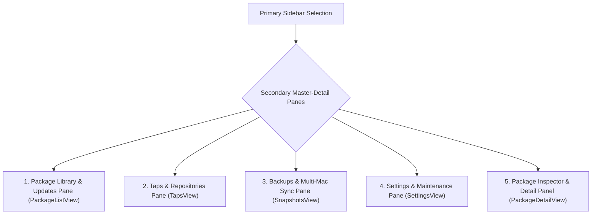

# 🤖 BrewStore Secondary Pane & Sub-Navigation: Complete Feature Test Guide

This document specifies **EVERY SINGLE feature, filter, batch action, contextual control, and sub-pane** available in the **Secondary Sidebar / Master-Detail Content Panes** of **BrewStore**.

---

## 🧭 Overview of Secondary Panes Architecture

When a primary sidebar item is selected, the adjacent **Secondary Pane** presents dedicated sub-navigation, multi-facet filtering, sorting engines, batch selection toolbars, and inspector panels:

---

## 📦 1. Package Library & Updates Secondary Pane (`PackageListView.swift`)

The central workhorse pane for browsing installed packages and pending updates:

### 1.1 Header Metrics & Action Deck

- **Dynamic Header Count**: Displays total package count and installed package count (e.g. `374 packages · 374 installed`).
- **Batch Selection Toggle (`Select` / `Done`)**:
  - Toggles checkboxes on all rows for multi-package operations.
  - Displays selected count indicator (e.g. `5 packages selected`).
- **Refresh Action (`arrow.clockwise`)**:
  - Triggers non-blocking background `brew` sync (`manager.refresh()`).
  - Disabled during active operations or loading states.
- **Mac App Store Updater (`apple.logo`)** *(Updates View Only)*:
  - Opens `MASView` sheet to scan and update apps installed from the Apple Mac App Store via the `mas` CLI.

### 1.2 Multi-Facet Filtering Bar

- **Package Kind Segmented Picker**:
  - `All`: Combines CLI tools and GUI apps.
  - `Apps (Casks)`: Filters exclusively to GUI `.app` bundles (`/Applications`).
  - `CLI (Formulae)`: Filters exclusively to command-line binaries in the Homebrew Cellar.
- **License Filter Dropdown Menu**:
  - `All Licenses` (`tag`)
  - `MIT License` (`checkmark.seal`)
  - `Apache 2.0` (`shield`)
  - `GPL / AGPL` (`globe`)
  - `BSD License` (`doc.text`)
  - `Proprietary` (`lock`)
- **Editorial Category Dropdown Menu**:
  - `All Curated` (`sparkles`)
  - `Essentials` (`star`)
  - `Developer Tools` (`hammer`)
  - `Utilities` (`wrench.and.screwdriver`)
  - `Productivity` (`briefcase`)
  - `Security` (`lock.shield`)
- **Tap Source Dropdown**:
  - Filters by repository source: `All Taps`, `homebrew/core`, `homebrew/cask`, or custom taps.
- **Pinned Only Filter Pill (`pin.fill`)**:
  - Filters the list exclusively to packages with version pinning active.
- **Active Filter Clear Chips**:
  - Shows interactive pill chips for all active filters with 1-click `xmark.circle.fill` removal.

### 1.3 Sorting & Grouping Engine

- **Grouping Dropdown Menu (`rectangle.3.group`)**:
  - `No Grouping`: Flat list.
  - `Group by Kind`: Sections for Formulae vs Casks.
  - `Group by Tap`: Grouped by origin repository.
  - `Group by License`: Grouped by Open-Source license.
  - `Group by Outdated Status`: Separates pending updates from up-to-date packages.
- **Sorting Dropdown Menu (`arrow.up.arrow.down`)**:
  - `Name A–Z` / `Name Z–A`
  - `Version`
  - `Install Date (Recent First)`
  - `Size on Disk (Largest First)`
  - `30-Day Install Popularity`

### 1.4 Batch Action Bar (In Selection Mode)

When `Select` is enabled, a bottom floating action toolbar appears:

- **`Select All` / `Deselect All`**: 1-click full selection toggle.
- **`Batch Pin` (`pin.fill`)**: Pins all selected packages to their current versions.
- **`Batch Unpin` (`pin.slash.fill`)**: Unpins all selected packages.
- **`Batch Reinstall` (`arrow.triangle.2.circlepath`)**: Reinstalls selected packages.
- **`Batch Uninstall` (`trash.fill`)**: Opens destructive confirmation dialog listing all impacted packages.

### 1.5 Package List Row (`PackageListRow`)

- **App Icon**: Real macOS `.icns` application icon for Casks or `terminal.fill` / `app.fill` SF symbol.
- **Title & Version**: Package name, semantic version number, and tap badge.
- **Live Reactive Badges**:
  - Yellow `star.fill` (if in Wishlist).
  - Orange `pin.fill` (if version pinned).
  - Orange `UPDATE` badge (if outdated).
- **`AppStoreActionButton`**:
  - `GET` (Blue pill) for uninstalled packages.
  - `UPDATE` (Prominent blue pill) for outdated packages.
  - `OPEN` (Bordered pill) for installed GUI Casks.
  - `INSTALLED` (Bordered pill with checkmark) for installed CLI Formulae.
- **Right-Click Context Menu**:
  - `Star (Add to Wishlist)` ⇄ `Unstar (Remove from Wishlist)` (`star.fill` / `star.slash`)
  - `Pin Version` ⇄ `Unpin Version` (`pin.fill` / `pin.slash.fill`)
  - `Open Application` / `Show in Finder` (for Casks)
  - `Show in Cellar` (for Formulae)
  - `Unlink Formula` (for Formulae)
  - `Uninstall` (destructive red action)

---

## 🚰 2. Taps & Repositories Secondary Pane (`TapsView.swift`)

The repository management sub-pane for third-party taps:

### 2.1 Tap List & Quick Actions

- **Header**: Active tap count and "Add Tap" button.
- **Tap Card / Row**:
  - Repository name (e.g. `homebrew/core`, `homebrew/cask-fonts`, `hashicorp/tap`).
  - Total package count originating from this tap.
  - Official vs Community verification badge.
  - GitHub remote URL link.
- **Tap Actions**:
  - **`Ecosystem Graph` (`TapGraphView`)**: Visual interactive node map connecting the tap to all installed binaries.
  - **`Explore Taps` (`TapDiscoveryView`)**: Curated discovery gallery of popular developer taps.
  - **`Add Custom Tap` (`TapAddSheet`)**: Input modal for custom Git URLs or shorthand `user/repo`.
  - **`Untap`**: Untap repository with confirmation sheet.

---

## 💾 3. Backups & Multi-Mac Sync Secondary Pane (`SnapshotsView.swift`)

The disaster recovery and device migration sub-pane:

### 3.1 Time Machine Snapshot Timeline

- **Snapshot Creation**: "Create Snapshot Now" with custom naming and timestamping.
- **Snapshot Cards**: Displays snapshot date, total formulae count, cask count, and tap count.
- **Snapshot Inspection & Diff**: View exact Brewfile manifest diff against current system state.
- **1-Click Restore**: Restores the entire system state back to any historical snapshot.

### 3.2 Multi-Mac Transfer Assistant (`MultiMachineSyncView.swift`)

- **1-Command Bootstrap Generator**:
  - Generates zero-dependency standalone bash script to clone the current Mac setup to a brand-new Mac.
  - 1-Click "Copy Script" and "Save to File".
- **AirDrop `.brewstore` Rig Export**:
  - Native macOS ShareLink export of portable `.brewstore` bundles containing formulas, casks, taps, and pinned versions.
- **Rig Import & Environmental Diff**:
  - Imports any `.brewstore` file and computes a visual diff showing missing tools on the current machine.
  - 1-Click "Install All Missing Tools".

---

## ⚙️ 4. Settings & Maintenance Secondary Pane (`SettingsView.swift`)

The configuration and tuning sub-pane:

### 4.1 Sub-Navigation Tabs

- **`General`**: Launch at login toggle, notification preferences, default package view.
- **`CDN Mirrors` (`BrewStoreMirrorManager`)**:
  - Real-time latency benchmark (ping in ms) across Fastly, USTC, TUNA, and Aliyun.
  - 1-Click "Apply Mirror" (modifies `HOMEBREW_BREW_GIT_REMOTE` and `HOMEBREW_CORE_GIT_REMOTE`).
- **`Background Updates` (`AutoUpdateScheduler`)**:
  - Toggle automated LaunchAgent background scans.
  - Interval picker: Every 1 hour, 6 hours, 12 hours, or 24 hours.
  - Notification alert settings.
- **`Storage & Purge` (`DiskStorageView`)**:
  - Reclaimable disk space hero banner (e.g. `3.42 GB Reclaimable`).
  - Purge Homebrew Download Cache (`brew cleanup --prune=all`).
  - Purge Build Logs (`~/Library/Logs/Homebrew/`).
  - Purge Inactive Historical Cellar Versions (`brew cleanup -s`).
- **`Theme & Vibrancy` (`BrewStoreThemeVibrancyManager`)**:
  - 5 Themes: Amber Brew, Cupertino Blue, Terminal Emerald, Cyberpunk Purple, Carbon Monochrome.
- **`Privacy`**:
  - 1-Click toggle to disable Homebrew analytics telemetry (`brew analytics off`).

---

## 🔍 5. Package Inspector & Detail Secondary Panel (`PackageDetailView.swift`)

The comprehensive package inspection panel:

### 5.1 App Store Header Deck

- **App Icon**: High-resolution icon with continuous corner radius.
- **Title, Package ID, and Kind Badge**: Name, formula ID, and `Formula` / `Cask` badge.
- **Star / Wishlist Button**: Toggles between `star.fill` (yellow) and `star` (secondary).
- **Advanced Install Options (`slider.horizontal.3`)**:
  - Opens sheet to configure custom flags (e.g. `--HEAD`, `--build-from-source`, `--force`).
- **Native ShareLink**: Shares formula link.

### 5.2 Version Management & Integrity

- **Version Switcher**: Dropdown menu allowing 1-click switching between installed historical versions (`switchActiveVersion`).
- **Version Pinning Section**:
  - Status banner indicating whether version upgrades are currently locked.
  - 1-Click "Pin Version" / "Unpin Version" toggle.
- **Update Muting**:
  - 1-Click toggle to mute notifications and exclude this package from `Upgrade All`.
- **Bottle Integrity Verification**:
  - Displays SHA-256 cryptographic bottle hash and macOS deployment target.

### 5.3 Dependency & Removal Analyzer

- **Interactive Dependency Tree**:
  - Visual tree graph showing upstream dependencies and required build tools.
- **Safe Removal Impact Plan (`BrewStoreRemovalPlan`)**:
  - Pre-analyzes whether removing this package will break any other installed applications before you click Uninstall.
- **Caveats & Caveats Banner**:
  - Displays special post-install instructions (e.g. `launchctl` commands or dotfile paths).
- **Raw JSON Inspector**:
  - Formatted JSON tree view of the raw Homebrew API response.

---

## 📋 Computer Use Secondary Pane Test Checklist

1. [ ] **Package List Filtering**:
   - Switch kind to `Apps (Casks)` ➔ Observe only GUI apps listed.
   - Switch kind to `CLI (Formulae)` ➔ Observe only CLI tools listed.
   - Select `MIT License` ➔ Observe list filtered to MIT packages.
   - Click `Pinned Only` pill ➔ Observe list filtered to pinned packages.
2. [ ] **Sorting & Grouping**:
   - Select `Group by Tap` ➔ Observe section headers for each tap.
   - Select `Size on Disk` sort ➔ Observe largest packages sorted to top.
3. [ ] **Batch Selection Mode**:
   - Click `Select` ➔ Checkboxes appear.
   - Select 3 packages ➔ Bottom batch bar appears with `Batch Pin`, `Batch Reinstall`, `Batch Uninstall`.
   - Click `Done` ➔ Checkboxes and batch bar disappear.
4. [ ] **Settings Sub-Panes**:
   - Click `CDN Mirrors` ➔ Run benchmark and observe latency times.
   - Click `Storage & Purge` ➔ Observe reclaimable bytes calculation and purge buttons.
5. [ ] **Package Detail Inspector**:
   - Click any package ➔ Observe header, version switcher, dependency tree, and bottle SHA-256 hash.
