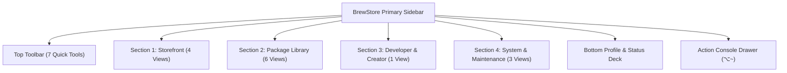

# 🤖 BrewStore Sidebar: Complete Feature & Computer Use Test Guide

This document is an exhaustive, feature-by-feature test and verification specification for the primary **BrewStore Navigation Sidebar** and every interactive control, modal, sheet, drawer, action, and context menu accessible from it.

---

## 🧭 Overview Of Sidebar Architecture

The primary sidebar (`BrewStoreRootView.swift`) is structured into **4 Primary Sections**, **7 Toolbar Quick-Action Items**, **1 Persistent Bottom Status / Profile Deck**, and **1 Collapsible Action Console Drawer**.

---

## 🛠️ Top Toolbar Quick Actions

Every button in the top toolbar provides instant access to global modal sheets and utilities:

### 1. `Import Brewfile` (`doc.badge.plus`)

- **Visual Trigger**: Top toolbar document icon with plus badge.
- **Action**: Opens `BrewfileImportView` sheet.
- **Features to Test**:
  - Drag-and-drop or file picker selection for any `Brewfile`.
  - Parses `tap`, `brew`, `cask`, and `mas` entries.
  - Interactive item selection checklist.
  - 1-Click "Import & Install All" batch runner.

### 2. `Health Score` (`heart.text.square`)

- **Visual Trigger**: Heart square icon in toolbar.
- **Action**: Opens `HealthScoreView` sheet.
- **Features to Test**:
  - Calculates real-time system health score (0–100) and letter grade (A/B/C/D).
  - Diagnostics overview cards: Outdated count, Cache size, Doctor warnings.
  - **Toolchain Dependency Doctor**: Scans for orphaned packages, unlinked Cellar binaries, and missing libraries (`brew missing`).
  - **1-Click Auto-Heal Toolchain**: Runs automated 3-step healing pipeline (`brew link`, `brew autoremove`, `brew cleanup`).
  - **CVE Security Audit**: Opens `CVESecurityView` sheet displaying known CVE vulnerabilities.

### 3. `AI Assistant` (`wand.and.stars`)

- **Visual Trigger**: Wand and stars icon in toolbar.
- **Action**: Opens `AISearchView` sheet.
- **Features to Test**:
  - Natural language prompt input (e.g. *"I need a fast terminal multiplexer"*).
  - Generates recommended package cards with 1-click install.
  - Interactive explanation of CLI options and configurations.

### 4. `Shell Setup` (`terminal`)

- **Visual Trigger**: Terminal prompt icon in toolbar.
- **Action**: Opens `ShellConfigView` sheet.
- **Features to Test**:
  - Detects current user shell (`/bin/zsh`, `/bin/bash`, `/opt/homebrew/bin/fish`).
  - Generates exact `export PATH` and `eval "$(/opt/homebrew/bin/brew shellenv)"` scripts.
  - 1-Click "Append to ~/.zshrc" / "Copy Configuration".

### 5. `Console Drawer` (`terminal.fill` / `terminal`)

- **Visual Trigger**: Terminal icon in toolbar (or keyboard shortcut **⌥~**).
- **Action**: Toggles the sliding bottom `ActionConsoleDrawer`.
- **Features to Test**:
  - Displays real-time streaming output of Homebrew shell commands.
  - Auto-scroll lock toggle, Clear logs button, and Copy logs button.

### 6. `Quick Open` (`command`)

- **Visual Trigger**: Command symbol in toolbar (or keyboard shortcut **⌘K**).
- **Action**: Opens `CommandPaletteView` modal.
- **Features to Test**:
  - Fuzzy search for packages, navigation sections, and maintenance tasks.
  - Arrow key navigation + Return to jump or execute.
  - Shows `star.fill` (yellow) and `pin.fill` (orange) badges next to package results.

### 7. `Help Manual` (`questionmark.circle`)

- **Visual Trigger**: Question mark circle icon (or keyboard shortcut **⌘?**).
- **Action**: Opens `HelpManualView` sheet.
- **Features to Test**:
  - Searchable guide covering Homebrew basics, Casks vs Formulae, Pinning, Taps, and Shortcuts.

---

## 🌟 Section 1: Storefront

### 1. `Discover` (`sparkles`)

- **Features**:
  - **Editorial Hero Carousel**: Displays Editor's Picks with slide indicator dots, left/right arrows, and a Star/Wishlist toggle button.
  - **Search & Filter Bar**: Instant search across thousands of packages, filtering by *All / Formulae / Casks / Popular*.
  - **Package List Row (`DiscoveryRow`)**: Displays name, description, 30-day install stats, yellow `star.fill` (if wishlisted), and orange `pin.fill` (if pinned).
  - **App Store Action Pill (`AppStoreActionButton`)**: Displays `GET`, `UPDATE`, `OPEN`, or `INSTALLED` with dropdown context actions.
  - **Detail Sheet (`DiscoveryDetailView`)**: Shows complete metadata, licenses, tap sources, dependency pills, Star toggle, and Pin/Unpin button.

### 2. `Stories` (`book.pages.fill`) *(Toggleable In Settings)*

- **Features**:
  - Rich markdown editorial articles, workflow guides, and featured developer setups.
  - Inline package mention pills with 1-click install action.

### 3. `Toolkits` / `Stacks` (`square.stack.3d.up.fill`) *(Toggleable In Settings)*

- **Features**:
  - **Curated 100% Free & Open-Source Bundles**: DevOps Kit, AI Engineer Suite, Privacy & Security, Web Developer Toolkit.
  - **Pricing Tier Badges**: Displays `100% Free & FOSS` green badges.
  - **Flow Chips (`FlowChipsView`)**: Displays formula & cask chips with checkmarks when installed, yellow `star.fill` when wishlisted, orange `pin.fill` when pinned, and right-click context menus.
  - **Custom Bundle Builder (`NewStackSheet`)**: Create custom bundles with custom names, icons, formula IDs, and cask IDs.
  - **Batch Actions**: "Install Missing Tools" and "Export Bundle to Brewfile".

### 4. `Categories` (`square.grid.2x2.fill`)

- **Features**:
  - **Horizontal Category Pills**: 8 categories (CLI Tools, Developer Utilities, Media, Privacy, Web & Cloud, Science, Productivity, System).
  - **Category Hero Banner**: Gradient header with category description and icon.
  - **Package Grid Cards (`CategoryPackageCard`)**: Responsive cards with app icons, yellow `star.fill`, orange `pin.fill`, `AppStoreActionButton`, and right-click context menu.

---

## 📦 Section 2: Package Library

### 1. `Installed` (`shippingbox.fill`)

- **Features**:
  - **Filter Tabs**: All Installed, CLI Formulae, GUI Apps, Pinned Only.
  - **Search & Selection Mode**: Checkbox multi-select for batch uninstall and batch pin operations.
  - **Package Rows (`PackageListRow`)**: Shows app icon, name, version, yellow `star.fill` (if wishlisted), orange `pin.fill` (if pinned), and `AppStoreActionButton`.
  - **Right-Click Context Menu**:
    - `Star (Add to Wishlist)` / `Unstar (Remove from Wishlist)`
    - `Pin Version` / `Unpin Version`
    - `Unlink Formula`
    - `Uninstall`
  - **Package Detail View (`PackageDetailView`)**:
    - Star button in header (`star.fill` vs `star`).
    - Pinned version badge in header.
    - Bottle integrity verification (SHA-256 checksum & build compiler).
    - Multi-version switcher dropdown (`switchActiveVersion`).
    - Ignore/Unignore future updates toggle (`BrewStoreIgnoredUpdatesManager`).
    - Smart Dependency Tree inspector (`brew deps --tree`).
    - Safe Uninstallation Impact Analyzer (`BrewStoreRemovalPlan`).

### 2. `Adoption & Replacements` (`arrow.down.app.fill`)

- **Features**:
  - **Tab 1: Adopt Unmanaged Apps**: Scans `/Applications` for apps installed outside Homebrew and offers 1-click adoption to Homebrew Cask management.
  - **Tab 2: Open-Source Replacements**: Curated directory suggesting FOSS Homebrew replacements for proprietary software (e.g. `mole` for CleanMyMac, `bitwarden` for 1Password).
  - **Replacement Cards**: Displays proprietary app vs FOSS replacement, advantage bullet points, Star button, Pin badge, and 1-click install.

### 3. `Dependencies` (`point.3.connected.trianglepath.dotted`)

- **Features**:
  - **Interactive Dependency Topology Graph**: Pan, zoom, and explore node relationships between installed packages.
  - **Inspect Dependents & Dependencies**: Scans upstream requirements and downstream reverse dependencies.
  - **Cyclic Dependency Scanner**: Flags dependency conflicts and circular chains.

### 4. `Wishlist` (`star.fill`)

- **Features**:
  - **Sidebar Badge**: Displays total wishlisted package count.
  - **Wishlist Rows (`wishlistRow`)**: Lists starred packages with yellow `star.fill` button for 1-click removal, orange `pin.fill` badge if pinned, and `AppStoreActionButton`.
  - **1-Click Batch Install**: "Install All Wishlisted" button.
  - **Export Wishlist**: "Export Wishlist as Brewfile" with copyable text.
  - **Custom Collections**: Create named collections of starred tools.

### 5. `Services` (`gearshape.2.fill`)

- **Features**:
  - **Sidebar Live Badge**: Displays number of currently running background daemons.
  - **Live Service Telemetry**: Displays running status, listening ports (e.g. `:5432`, `:6379`), CPU %, memory footprint, and uptime.
  - **Service Actions**: `Start`, `Stop`, `Restart`, `Kill`.
  - **Registered Ports Inspector**: View all open ports managed by Homebrew services.

### 6. `Taps` (`square.3.layers.3d.down.forward`)

- **Features**:
  - **Tap Repository List**: Lists all tapped repositories (e.g. `homebrew/core`, `homebrew/cask`).
  - **Tap Ecosystem Graph (`TapGraphView`)**: Visual node graph of packages installed from each tap.
  - **Tap Discovery (`TapDiscoveryView`)**: Curated directory of popular official and community taps.
  - **Add Tap Sheet (`TapAddSheet`)**: Add custom taps via URL or repository shorthand.
  - **Untap Action**: Untap repository with safety confirmation.

---

## 🔨 Section 3: Developer & Creator

### 1. `Creator Studio` (`hammer.circle.fill`)

- **Features**:
  - **Tap Maintainer Workbench**: Telemetry on public GitHub tap repositories, star counts, and local install numbers.
  - **Formula Generator Wizard (`NewFormulaWizardSheet`)**: Step-by-step form to generate ruby formula files (`.rb`) with automatic checksum fetching.
  - **Formula Linter & Auditor**: Runs `brew audit --strict --online` directly from UI.
  - **Tap Scaffolding**: Automatically creates Git repository structure for new custom taps.

---

## ⚙️ Section 4: System & Maintenance

### 1. `Updates` (`arrow.triangle.2.circlepath`)

- **Features**:
  - **Sidebar Outdated Count Badge**: Orange counter badge displaying pending updates.
  - **Batch Upgrade**: 1-Click "Upgrade All Outdated Packages" button.
  - **Outdated Package Inspection**: Shows current installed version vs new available version.
  - **Update Muting**: Skip/Mute updates for specific packages (`BrewStoreIgnoredUpdatesManager`).

### 2. `Backups` (`camera.fill`)

- **Features**:
  - **Time Machine Snapshots (`SnapshotsView`)**: Create, inspect, restore, and delete full Homebrew toolchain snapshots.
  - **Multi-Mac Sync Assistant (`MultiMachineSyncView`)**:
    - **1-Command Bootstrap Generator**: Generates standalone bash script to setup a fresh Mac.
    - **AirDrop Rig Export**: Exports portable `.brewstore` rig file via native macOS ShareLink.
    - **Rig File Import**: Imports `.brewstore` file and computes cross-Mac missing package diff.
    - **1-Click Sync**: "Install All Missing" from remote Mac profile.

### 3. `Settings` (`gearshape.fill`)

- **Features**:
  - **CDN Mirror Benchmarker**: Live ping benchmark for Fastly, USTC, TUNA, and Aliyun mirrors with 1-click active mirror switching.
  - **Background Auto-Update Scheduler**: Configure automatic background scans (Every 1h, 6h, 12h, 24h) and notifications.
  - **Deep Storage & Cache Purge Manager (`DiskStorageView`)**:
    - Reclaimable disk space hero banner.
    - Purge Download Cache (`brew cleanup --prune=all`).
    - Purge Build Logs (`~/Library/Logs/Homebrew/`).
    - Purge Inactive Historical Cellar Versions (`brew cleanup -s`).
  - **Theme & Vibrancy**: Amber Brew, Cupertino Blue, Terminal Emerald, Cyberpunk Purple, Carbon Monochrome.
  - **Homebrew Analytics Privacy**: 1-Click toggle to disable Homebrew telemetry (`brew analytics off`).

---

## 👤 Bottom Sidebar Profile & Status Deck

- **Active Operation Bar**: Spinning progress ring, active operation title, status message, and red `Cancel` button.
- **GitHub Account Profile Tile**:
  - Displays user avatar and `@username` (or *"Sign In with GitHub"*).
  - Displays GitHub API rate limits remaining (e.g. `4982 req/hr`).
  - Clicking opens `GitHubAccountView` to authenticate via Personal Access Token (PAT).
- **Homebrew Core Status Indicator**:
  - Live green / orange dot.
  - Architecture badge: `Apple Silicon` (`/opt/homebrew`) vs `Intel` (`/usr/local`).

---

## 📋 Computer Use Verification Checklist

When validating BrewStore via Computer Use, execute the following actions in sequence:

1. [ ] **Click each sidebar tab from top to bottom**:
   - `Discover` ➔ `Stories` ➔ `Toolkits` ➔ `Categories` ➔ `Installed` ➔ `Adoption` ➔ `Dependencies` ➔ `Wishlist` ➔ `Services` ➔ `Taps` ➔ `Creator Studio` ➔ `Updates` ➔ `Backups` ➔ `Settings`.
2. [ ] **Click each top toolbar icon**:
   - `Import Brewfile` modal opens and closes.
   - `Health Score` modal opens, displays score, and Auto-Heal button is present.
   - `AI Assistant` modal opens with prompt box.
   - `Shell Setup` modal opens with shell scripts.
   - `Console Drawer` (⌥~) slides up and down.
   - `Quick Open` (⌘K) displays palette search.
   - `Help Manual` (⌘?) displays documentation.
3. [ ] **Verify Star / Wishlist Toggles**:
   - Star a package ➔ Observe yellow `star.fill` in row header, detail header, and sidebar badge incrementing.
   - Unstar the package ➔ Observe icon returning to gray unfilled `star` and sidebar badge decrementing.
4. [ ] **Verify Pin / Unpin Toggles**:
   - Pin a formula ➔ Observe orange `pin.fill` badge appearing, and button changing to `"Unpin Version"` (`pin.slash.fill`).
   - Unpin the formula ➔ Observe badge disappearing and button changing to `"Pin Version"` (`pin.fill`).
5. [ ] **Verify Bottom Status Deck**:
   - Click GitHub profile tile ➔ `GitHubAccountView` sheet opens.
   - Trigger an operation (e.g. Refresh) ➔ Bottom progress bar appears with `Cancel` button.
