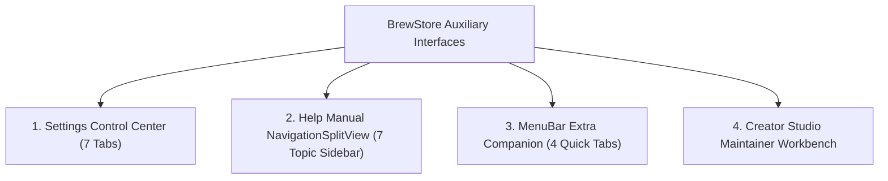

# 🤖 BrewStore Dedicated Sub-Sidebars & Auxiliary Panes: Feature Test Guide

This document details **EVERY SINGLE feature, setting toggle, documentation topic, and diagnostic workflow** in BrewStore's dedicated modal and sub-split sidebars: **Settings Control Center**, **Help Manual NavigationSplitView**, and **MenuBar Extra Companion**.

---

## 🧭 Overview Of Dedicated Navigation Sidebars

---

## ⚙️ 1. Settings Control Center Sidebar (`SettingsView.swift`)

The settings interface is organized into **7 Dedicated Sections** accessible via a responsive tab sidebar:

### 1.1 `General` (`gearshape.fill`)

- **Launch & Startup**:
  - `Launch BrewStore at Login` toggle (`SMAppService` integration).
  - `Open Minimized to Menu Bar` toggle.
- **Official Application Release Updater**:
  - Displays current version (`v1.0.0`) and release status.
  - "Check for App Updates" button.
  - Quick access to download DMG or view GitHub release notes.
- **Official Homebrew Tap Auto-Sync**:
  - 1-Click commands to repair or tap `homebrew/core` and `homebrew/cask`.
- **Background Scan Frequency**:
  - Dropdown selector: `Every 1 hour`, `Every 6 hours`, `Every 12 hours`, `Every 24 hours`.
- **System Notifications**:
  - `Notify on Available Updates` toggle.
  - `Notify on Service Crashes / Watchdog Events` toggle.

### 1.2 `Appearance` (`paintbrush.fill`)

- **Theme Palettes (`BrewStoreThemeVibrancyManager`)**:
  - `Amber Brew` (Warm default gold/orange)
  - `Cupertino Blue` (macOS native accent)
  - `Terminal Emerald` (Hacker green)
  - `Cyberpunk Purple` (Neon electric purple)
  - `Carbon Monochrome` (Minimalist slate/gray)
- **Vibrancy & Material**:
  - `Full Glass Vibrancy` vs `Solid Native` contrast toggle.
  - Sidebar transparency slider.

### 1.3 `Innovations` (`sparkles`)

- **Feature Flag Toggles**:
  - `Enable AI Package Assistant` toggle.
  - `Enable Curated Editorial Stories` toggle.
  - `Enable 100% Free & FOSS Developer Stacks` toggle.
  - `Enable Dependency Topology Graphs` toggle.

### 1.4 `Network & Mirrors` (`network`)

- **Concurrent CDN Speed Benchmark (`BrewStoreMirrorBenchmarkManager`)**:
  - Live latency testing table across Fastly CDN, USTC Mirror, Tsinghua TUNA, and Aliyun.
  - `Test Mirror Latencies` action button with concurrent asynchronous pings.
  - Green `FASTEST` latency badge indicator.
- **Shell Export Snippet Generator**:
  - 1-Click "Copy Shell Export Config" generating `HOMEBREW_BREW_GIT_REMOTE` and `HOMEBREW_CORE_GIT_REMOTE`.
- **Dual-Homebrew Architecture Switcher (`BrewStorePrefixManager`)**:
  - Live detection of Apple Silicon (`/opt/homebrew`) and Intel (`/usr/local`) installations.
  - Active prefix switcher with system PATH validation.

### 1.5 `Snapshots & Brewfile` (`clock.arrow.circlepath`)

- **Automated Snapshots**:
  - `Auto-Create Snapshot Before Upgrades` toggle.
  - `Keep Last N Snapshots` (5, 10, 25, Unlimited).
- **Gist Cloud Sync**:
  - Sync Brewfile backup manifests directly to private GitHub Gists via authenticated GitHub Account.

### 1.6 `Doctor & Health` (`stethoscope`)

- **Automated Toolchain Diagnostics**:
  - `Run brew doctor` button with live log stream.
  - `Run brew missing` button to detect broken dylib links.
  - `Run brew autoremove` button to prune unneeded dependencies.
  - Health score summary and grade calculation.

### 1.7 `Storage & Privacy` (`externaldrive.fill`)

- **Granular Storage Allocation Breakdown**:
  - Displays exact bytes for `Cellar`, `Caskroom`, `Download Cache`, `Build Logs`, and `Total Allocated`.
- **1-Click Deep Purges (`DiskStorageView`)**:
  - `Purge Download Cache` (`brew cleanup --prune=all`).
  - `Purge Build Logs` (`~/Library/Logs/Homebrew/`).
  - `Purge Inactive Historical Cellar Versions` (`brew cleanup -s`).
- **Telemetry Privacy**:
  - 1-Click toggle to disable Homebrew anonymous analytics (`brew analytics off`).
- **Operation History Log**:
  - Audit trail of past installs, uninstalls, and updates with timestamps and exit statuses.

---

## 📖 2. Help Manual NavigationSplitView Sidebar (`HelpManualView.swift`)

The Help Manual is built with a native `NavigationSplitView` featuring a dedicated **7-Topic Left Sidebar** and interactive search bar:

### 2.1 Help Topic Sidebar Items

1. **`Getting Started` (`sparkles`)**:
   - Welcome overview, macOS App Store design paradigms, and Casks vs Formulae breakdown.
2. **`Background Services` (`gearshape.2.fill`)**:
   - Guide to `launchd` background daemons, viewing logs, CPU telemetry, and service port management.
3. **`Snapshots & Disaster Recovery` (`camera.fill`)**:
   - Creating system restore points, multi-Mac bootstrap scripts, and AirDrop rig transfers.
4. **`Taps & Custom Repositories` (`square.3.layers.3d.down.forward`)**:
   - Tapping third-party GitHub repositories, security auditing, and untapping protocols.
5. **`Pinning & Package Management` (`pin.fill`)**:
   - Freezing formula versions (`brew pin`), muting update alerts, and version switcher usage.
6. **`Health Score & Dependency Doctor` (`heart.text.square`)**:
   - Health score metrics (0–100), repairing orphaned binaries, and CVE vulnerability scans.
7. **`Keyboard Shortcuts & Power Features` (`command`)**:
   - Complete cheat sheet of navigation shortcuts (**⌘1**–**⌘9**, **⌘0**, **⌘K**, **⌘?**, **⌥~**, **⌘R**, **⌥⌘U**).

### 2.2 Interactive Features

- **Searchable Topics**: Instant filtering of topics, headings, and paragraphs via `searchable(text:)`.
- **Actionable Callout Tips**: GitHub-style warning/tip boxes.
- **Copyable Code Snippets**: Ready-to-run terminal commands.

---

## 💻 3. MenuBar Extra Companion Sidebar (`MenuBarExtraView.swift`)

The lightweight, persistent macOS Menu Bar companion (`BrewStoreMenuBarCompanion`):

### 3.1 4-Tab Navigation Strip

1. **`Search` (`magnifyingglass`)**: Quick package lookup without opening the main window.
2. **`Updates` (`arrow.triangle.2.circlepath`)**:
   - Displays pending update badges and 1-Click "Update All" button.
3. **`Services` (`gearshape.2.fill`)**:
   - Live daemon list with start/stop toggles and listening port badges (`:5432`, `:6379`).
4. **`Maintenance` (`wrench.and.screwdriver.fill`)**:
   - Quick Doctor run, Cache Cleanup, and Open Full BrewStore App.

---

## 📋 Computer Use Sub-Sidebar Test Checklist

1. [ ] **Settings Navigation**:
   - Click `General` ➔ Verify updater and LaunchAgent toggles.
   - Click `Appearance` ➔ Toggle themes (`Terminal Emerald`, `Amber Brew`) and observe tint change.
   - Click `Network & Mirrors` ➔ Click `Test Mirror Latencies` and verify concurrent pings (<2s).
   - Click `Storage & Privacy` ➔ Verify storage metrics and cache purge triggers.
2. [ ] **Help Manual Split View**:
   - Click each of the 7 topics ➔ Observe header, paragraphs, tips, and code blocks.
   - Search `"shortcuts"` in help search bar ➔ Observe topics filtered to Keyboard Shortcuts.
3. [ ] **MenuBar Extra**:
   - Switch between Search, Updates, Services, and Maintenance tabs.
